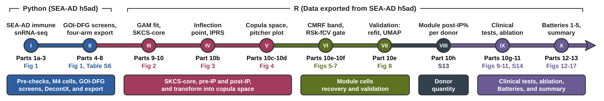

<div align="center">


# CEP-IP with CMRF in SEA-AD Microglia:<br>A Mitochondrial Co-expression Module Linked to Cognition

[](https://github.com/kahkengwong/CEP-IP_with_CMRF_in_SEA-AD)
[](https://huggingface.co/datasets/kahkengwong/CEP-IP_with_CMRF_in_SEA-AD)
[](https://zenodo.org/records/23445742)
[](https://doi.org/BIORXIV_DOI)
[](#6-reproducing-the-analysis)
[](https://github.com/kahkengwong/cepip)


[](#101-software-requirements)
[](#101-software-requirements)
[](https://github.com/kahkengwong/CEP-IP_with_CMRF_in_SEA-AD)

### Author: Kah Keng Wong [](https://orcid.org/0000-0001-7359-6202)

**R package:** the methods of this study (CEP-IP, SKCS, and CMRF) are available as the R package [cepip](https://github.com/kahkengwong/cepip), for use on other single-cell datasets.

<table>
<tr><th align="center" colspan="3">Table of Contents</th></tr>
<tr><th align="left">No.</th><th align="left">Section</th><th align="left">Descriptions</th></tr>
<tr><td align="left" colspan="3"><b>About the study</b></td></tr>
<tr><td align="left"><b>1</b></td><td align="left"><a href="#1-overview">Overview</a></td><td align="left">The study in brief and the datasets</td></tr>
<tr><td align="left"><b>2</b></td><td align="left"><a href="#2-workflow-of-the-project">Workflow</a></td><td align="left">Pipeline from the SEA-AD h5ad to the Batteries</td></tr>
<tr><td align="left"><b>3</b></td><td align="left"><a href="#3-methods-and-key-results">Methods and Key Results</a></td><td align="left">Five figures of the main steps</td></tr>
<tr><td align="left" colspan="3"><b>The code</b></td></tr>
<tr><td align="left"><b>4</b></td><td align="left"><a href="#4-repository-contents">Repository Contents</a></td><td align="left">What each folder holds</td></tr>
<tr><td align="left"><b>5</b></td><td align="left"><a href="#5-descriptions-of-the-scripts">Descriptions of the Scripts</a></td><td align="left">Every script, its role, and its paper output</td></tr>
<tr><td align="left" colspan="3"><b>Running and checking the analysis</b></td></tr>
<tr><td align="left"><b>6</b></td><td align="left"><a href="#6-reproducing-the-analysis">Reproducing the Analysis</a></td><td align="left">Data, container, and run commands</td></tr>
<tr><td align="left"><b>7</b></td><td align="left"><a href="#7-reproducibility-check">Reproducibility Check</a></td><td align="left">Container rerun compared with the original results</td></tr>
<tr><td align="left"><b>8</b></td><td align="left"><a href="#8-external-validation">External Validation</a></td><td align="left">The pipeline on independent datasets with the R package cepip</td></tr>
<tr><td align="left" colspan="3"><b>Files and requirements</b></td></tr>
<tr><td align="left"><b>9</b></td><td align="left"><a href="#9-supplementary-tables--figures-zenodo">Supplementary Tables and Figures</a></td><td align="left">Supplementary Tables and Figures on Zenodo</td></tr>
<tr><td align="left"><b>10</b></td><td align="left"><a href="#10-requirements">Requirements</a></td><td align="left">Software and hardware</td></tr>
<tr><td align="left" colspan="3"><b>Using this work</b></td></tr>
<tr><td align="left"><b>11</b></td><td align="left"><a href="#11-license">License</a></td><td align="left">MIT License and the SEA-AD data terms</td></tr>
<tr><td align="left"><b>12</b></td><td align="left"><a href="#12-citation">Citation</a></td><td align="left">How to cite the preprint and the framework</td></tr>
<tr><td align="left"><b>13</b></td><td align="left"><a href="#13-contact">Contact</a></td><td align="left">Email</td></tr>
</table>

</div>

<br>

<details>
<summary><strong>Abstract (click to expand)</strong></summary>

**Background:** Single-nucleus RNA-seq (snRNA-seq) studies of Alzheimer's disease (AD) routinely filter nuclei by mitochondrial percentage (%MT) or remove mitochondrial genes, yet whether these reads carry information about cognition is rarely examined.

**Methods:** In the SEA-AD microglia snRNA-seq dataset, a transcriptome-wide screen identified a module of *MT-CO3* and eight co-expressed mitochondrial genes. Three microglial populations were analyzed: M4 (Mic.13-like), PVM_3, and PVM_1, with a housekeeping-gene control in M4 cells. The CEP-IP pipeline with a copula monotone recovery filter (CMRF) used per-cell Spearman and Kendall scores, an inflection point (IP), and a cross-validated copula space boundary to isolate *MT-CO3* Module cells.

**Results:** The donor percentage of Module cells past the IP (Module post-IP%) was significantly associated with worse cognition (MMSE and CASI; FDR<0.05) in all three populations. In M4 and PVM_3, these associations remained significant after adjustment for tissue quality, plaque burden, tangle burden, and contamination, and after doublet removal. M4 and PVM_3 Module post-IP% repeated in each donor's regions beyond chance, and no per-cell %MT cutoff reproduced the Module cells. However, at the donor level, Module post-IP% could not be separated from mean %MT, and the source of the mitochondrial transcripts (e.g., retained cytoplasm or a true change in mitochondrial content) remains unresolved.

**Conclusions:** Routine %MT filtering in AD snRNA-seq may therefore remove cells that carry information about cognition. The full pipeline code, software container, processed data, and the R package cepip are publicly available, and reruns of the full pipeline in the container reproduced the original findings.

> K.K. Wong (2026). CEP-IP with CMRF in SEA-AD Microglia: A Mitochondrial Co-expression Module Linked to Cognition. *bioRxiv*. https://doi.org/BIORXIV_DOI

</details>

<br>

<strong>Highlights</strong>

- The **CEP-IP** framework with a **copula monotone recovery filter (CMRF)** applied to the **SEA-AD** immune single-nucleus RNA-seq dataset (84 donors, 10 brain regions).
- A transcriptome-wide screen identified a module of **MT-CO3** and eight co-expressed mitochondrially encoded genes (cDFG).
- The donor percentage of **Module post-IP** cells was tested against cognition and pathology.
- Five **Batteries** of analyses tested contamination, measurement artifacts, %MT, and the 11 severely affected (SA) donors.
- The pipeline was run on independent snRNA-seq datasets with the R package cepip, with pre-specified readings ([Section 8](#8-external-validation)).
- The methods are available as the R package [**cepip**](https://github.com/kahkengwong/cepip) for use on other datasets.

---

## 1. Overview
- This repository holds the analysis code, the software environment (container recipe and lock files), and the reproducibility check for the preprint. It builds on the published **CEP-IP framework** ([Wong, 2026, *CMPB*](https://doi.org/10.1016/j.cmpb.2026.109372); [code](https://github.com/kahkengwong/CEP-IP_Framework)).

- The methods of this study (CEP-IP, SKCS, and CMRF) are available as the R package [`cepip`](https://github.com/kahkengwong/cepip), for use on other datasets. The package reproduces the PVM_3 and HKG8 arms of this study: its script `reproduce_seaad.R` checks 698 published values, and all of them agree.

- **Python Parts 1 to 8** read the SEA-AD immune h5ad: pre-checks, Mic.13-like (M4) cell selection, the GOI-DFG screens, DecontX, and the export of each arm for R.

- **R Parts 9 to 13** take the data exported from the SEA-AD h5ad by Part 8: GAM fits, the Spearman-Kendall cell-level scores (SKCS), the inflection point (IP and IPRS), copula space, the CMRF Module, differential expression, the donor-level clinical models, the Module boundary ablation, the five Batteries (Part 12), and the M4 analyses (Part 13).

**Four arms are analyzed in parallel:**
1. **M4** - Mic.13-like cells shortlisted from Micro-PVM_3 cells (primary arm).
2. **PVM_3** - all Micro-PVM_3 cells.
3. **PVM_1** - all Micro-PVM_1 cells.
4. **HKG8** - control: the M4 cells analyzed with ACTB as the gene of interest (GOI) and eight other housekeeping genes as its partners.

**Region sets:** neocortical regions (NeoC; DFC, MTG, AnG, STG, V1C, ITG) and non-neocortical regions (NonNeoC; HIP, MEC, LEC, FI).

---

### 1.1 Datasets Used

<table>
<tr><th align="left">Item</th><th align="left">Details</th></tr>
<tr><td align="left" colspan="2"><b>1. SEA-AD immune snRNA-seq dataset</b></td></tr>
<tr><td align="left"><b>Release</b></td><td align="left">Multiregion release of 22 June 2026</td></tr>
<tr><td align="left"><b>Files</b></td><td align="left"><ul><li>Immune h5ad: <code>SEAAD_Immune_HIP_MEC_LEC_ITG_MTG_FI_STG_DFC_AnG_V1C_RNAseq_final-nuclei.2026-06-22.h5ad</code></li><li>Quantitative neuropathology workbook: <code>sea-ad-quantitative-neuropathology-063026.xlsx</code></li><li>CPS workbook: <code>sea-ad_global_and_local_cps_050126.xlsx</code></li><li>Donor metadata workbook: <code>MetaData/sea-ad_cohort_donor_metadata_072524.xlsx</code></li></ul></td></tr>
<tr><td align="left"><b>Used in</b></td><td align="left">Python Parts 1 to 8 and Part 12</td></tr>
<tr><td align="left"><b>Available from</b></td><td align="left"><a href="https://brain-map.org/consortia/sea-ad/our-data">SEA-AD portal</a></td></tr>
<tr><td align="left"><b>References</b></td><td align="left"><ul><li>M.I. Gabitto, K.J. Travaglini, V.M. Rachleff, E.S. Kaplan, B. Long, et al., Integrated multimodal cell atlas of Alzheimer's disease, Nat Neurosci, 27 (2024) 2366-2383. <a href="https://doi.org/10.1038/s41593-024-01774-5">https://doi.org/10.1038/s41593-024-01774-5</a></li><li>K.J. Travaglini, M.I. Gabitto, Y. Ding, A. Agrawal, N. Postupna, et al., Multiregional single-cell profiling reveals shared and specialized cellular vulnerability in Alzheimer’s disease, bioRxiv, (2026). <a href="https://www.biorxiv.org/content/10.64898/2026.07.01.734821v1">https://www.biorxiv.org/content/10.64898/2026.07.01.734821v1</a></li></ul></td></tr>
<tr><td align="left" colspan="2"><b>2. Gerrits et al. single-nucleus dataset (GSE148822)</b></td></tr>
<tr><td align="left"><b>Used in</b></td><td align="left">Battery 1 (ambient RNA)</td></tr>
<tr><td align="left"><b>Available from</b></td><td align="left"><a href="https://www.ncbi.nlm.nih.gov/geo/query/acc.cgi?acc=GSE148822">GEO</a></td></tr>
<tr><td align="left"><b>Reference</b></td><td align="left">E. Gerrits, N. Brouwer, S.M. Kooistra, M.E. Woodbury, Y. Vermeiren, et al., Distinct amyloid-beta and tau-associated microglia profiles in Alzheimer's disease, Acta Neuropathol, 141 (2021) 681-696. doi: 10.1007/s00401-021-02263-w</td></tr>
<tr><td align="left" colspan="2"><b>3. External dataset 1: Pineda et al. (2024)</b></td></tr>
<tr><td align="left"><b>Used in</b></td><td align="left">External validation 1 (<a href="#8-external-validation">Section 8</a>)</td></tr>
<tr><td align="left"><b>Details</b></td><td align="left">To be added.</td></tr>
<tr><td align="left" colspan="2"><b>4. External dataset 2: Rexach et al. (2024), insula</b></td></tr>
<tr><td align="left"><b>Files</b></td><td align="left"><ul><li>CELLxGENE h5ad: <code>aa87f914-07e0-48aa-b915-8de906c95baf.h5ad</code> (raw counts, insula)</li><li>Table S1 of the paper: <code>mmc1.xlsx</code> (age at death and PMI)</li></ul></td></tr>
<tr><td align="left"><b>Used in</b></td><td align="left">External validation 2 (<a href="#8-external-validation">Section 8</a>)</td></tr>
<tr><td align="left"><b>Available from</b></td><td align="left"><a href="https://cellxgene.cziscience.com/collections/c53573b2-eff4-4c5e-9ad0-b24d422dfd9b">CELLxGENE</a>; Table S1 from the Supplemental Information of the paper</td></tr>
<tr><td align="left"><b>Reference</b></td><td align="left">J.E. Rexach, Y. Cheng, L. Chen, D. Polioudakis, L.-C. Lin, et al., Cross-disorder and disease-specific pathways in dementia revealed by single-cell genomics, Cell, 187 (2024) 5753-5774. <a href="https://doi.org/10.1016/j.cell.2024.08.019">https://doi.org/10.1016/j.cell.2024.08.019</a></td></tr>
</table>

---

## 2. Workflow of the Project
<p align="center"></p>

> [!NOTE]
> The figure and table numbers in the workflow are those of the preprint; S numbers refer to its Supplementary Methods, Figures, and Tables. Figures 1 to 5 in the Methods and Key Results section are separate figures made for this README.

- The **GOI-DFG screen** ranks every gene as a GOI against all expressed partner genes with the Spearman-Kendall dual filter (r<sub>s</sub> ≥0.6 and τ<sub>b</sub> ≥0.5). MT-CO3 was the top-ranked mitochondrial GOI, and its eight DFGs were averaged into the composite cDFG.

- The population r<sub>s</sub> and τ<sub>b</sub> of MT-CO3 with cDFG are decomposed into the cell-level scores S<sub>i</sub> and K<sub>i</sub>. Cells passing cutoffs on both form the **SKCS-core**.

- The **inflection point (IP)** is located on a GAM fit of cDFG on MT-CO3, and the fitted cDFG at the IP (IP<sub>y</sub>) splits cells into **pre-IP** and **post-IP**.

- In copula space, the **CMRF** recovers cells that follow the same monotonic relationship as the SKCS-core, with a cross-validated boundary, to form the **Module**.

- The donor percentage of Module cells at or above IP<sub>y</sub> (**Module post-IP%**) is tested against clinical outcomes, then challenged by the five Batteries.

---

## 3. Methods and Key Results
The five figures below follow the main steps of the analysis, using M4 NeoC as the example where one arm is shown.

> [!NOTE]
> The R package [cepip](https://github.com/kahkengwong/cepip) draws these plots for any pair of a gene and its partner genes. Its README explains each step on the PVM_3 NeoC cells in a [worked example](https://github.com/kahkengwong/cepip#4-worked-example).

<p align="center"></p>

**Figure 1. The S<sub>i</sub> and K<sub>i</sub> gates create a discontinuity.** The S<sub>i</sub> and K<sub>i</sub> gates (S<sub>i</sub> >0.05 and K<sub>i</sub> >0.5) identified the SKCS-core cells and improved the deviance explained (DE; from 67.4% to 87.7% in M4 NeoC), but created a discontinuity along MT-CO3 that is also visible in the pitcher plot (K<sub>i</sub> against S<sub>i</sub>).

<br>
<br>


<p align="center"></p>

**Figure 2. Transformation into copula space.** The expression space (cDFG against MT-CO3) and the score space (K<sub>i</sub> against S<sub>i</sub>) are transformed into copula space by ranking each axis and dividing by n + 1: v against u for the expression values, and v<sub>SK</sub> against u<sub>SK</sub> for the S<sub>i</sub> and K<sub>i</sub> values.

<br>
<br>


<p align="center"></p>

**Figure 3. CMRF reclaims monotone-coherent cells.** The copula monotone recovery filter (CMRF) reclaimed monotone-coherent cells that the fixed S<sub>i</sub> and K<sub>i</sub> gates had excluded. The SKCS-core cells calibrated the spline, two bands (&delta;<sub>base</sub> and &delta;<sub>adapt</sub>) identified the candidates, and the RSk-fCV gate tested them. Purple diamonds are the Recovered cells.

<br>
<br>


<p align="center"></p>

**Figure 4. Pitcher plots as a quality check of CMRF.** Pitcher plots in copula space for each arm and region set. The Recovered cells (purple) bridge the post-IP (green) and pre-IP (amber) branches.

<br>
<br>


<p align="center"></p>

**Figure 5. Applications of Module post-IP%.** Module post-IP% was computed for each arm (A) and used in downstream applications, such as its association with cognition and pathology outcomes in the SEA-AD donors, where it was benchmarked against the competitors of CMRF (B).

---

## 4. Repository Contents
| Path | Contents |
|---|---|
| `scripts/Python/` | <ul><li>The 23 Python scripts: Parts 1 to 8 and the Part 12 extraction step (`Part12_02_Extract.py`)</li><li>`Mic13_genes.txt`: the Mic.13 gene table read by Part 5b (from Green et al. 2024, Extended Data Fig. 2c)</li></ul> |
| `scripts/R/` | <ul><li>The R scripts of Parts 9 to 13 and `Fig17_Summary_code.r`</li><li>The shared arm table and settings: `CEP_arms.R`, `R_config.R`, `R_config_HKG8.R`</li><li>The Part 12 settings: `Part12_01_config.json`, `Part12_Fig19_config.json`</li><li>The pre-specified readings of the Batteries: `Part12_Preset_Readings.md`, `Part12_Preset_Readings_Battery5.md`</li></ul> |
| `scripts/SuppTables/` | The scripts that build Supplementary Tables S1 to S19 from the pipeline outputs:<ul><li>One builder per table: `build_SuppTable_S<n>`</li><li>`finalize_supp_tables.py`: published sheet names, Contents and wording, from `supp_tables_contents.json`</li><li>`run_supp_tables.sh`</li><li>`compare_supp_tables.py`</li></ul> |
| `Containerfile` | Recipe for the container image (R 4.6.1, Python 3.13.14, all packages). Works with Podman or Docker. |
| `seaad-setup.sh` | Run once inside the container: copies the settings into the data folder and checks the inputs. |
| `seaad-run.sh` | The one-command run (`seaad-run` in the container): runs the whole analysis, or part of it, in order, with a log per step. |
| `README_container.md` | Container build, inputs, and the full run order. |
| `renv.lock` | Exact R package versions (R 4.6.1, Bioconductor 3.23; 280 packages). |
| `requirements-python.txt` | Exact Python package versions (Python 3.13.14). |
| `verification/` | <ul><li>`run_rest.sh` and `run_python.sh`: the run scripts used for the reproducibility check, before `seaad-run`</li><li>`compare_rerun.py`, `compare_python.py`, and `compare_gamdata.py`: compare a rerun with the original results</li><li>The comparisons of the container reruns with the original results: `compare_all_*` for R; `compare_python_*` and `compare_gamdata_log.txt` for Python</li></ul> |
| `external_validation/` | <ul><li>`External2_Rexach_Preset_Readings.md`: the pre-specified readings of external validation 2, committed before any statistic was computed</li><li>`Rexach/`: the container recipe, the run script `rexach-run`, the scripts R11 to R17, the Table S21 builder, the WSL step scripts, and `README_container_Rexach.md`</li><li>`Rexach/verification/`: the comparisons of the container reruns with the original results</li><li>External validation 1 (Pineda): to be added</li></ul> |
| `figures/` | The workflow figure (`Workflow.png`) and Figures 1 to 5 of the Methods and Key Results section. |
| `logs/` | <ul><li>`container_rerun/`: console logs of the container rerun of R Part 9 onward and the Part 12 Python step</li><li>`container_rerun_python/`: console logs of the container rerun of Python Parts 1 to 8</li><li>`container_fullrun/`: console logs of the one-command run (`seaad-run all`) in a new folder</li><li>`original_R/`: logs of the original runs from Part 9 onward</li><li>`original_python/`: logs of the original runs of Python Parts 1 to 8</li><li>`logs/README.md` describes each folder and maps the Python logs to their scripts</li></ul> |

---

## 5. Descriptions of the Scripts
Figure and table numbers are those of the preprint.

> [!NOTE]
> The Part 12 file names (`Fig15` to `Fig19`) follow the run order of the Batteries; they correspond to preprint Figures 12 to 16.

<details>
<summary><strong>Python scripts (SEA-AD h5ad): Parts 1 to 8 and the Part 12 extraction (click to expand)</strong></summary>

| No | Script File | Description | Paper output |
|----|---|---|---|
| 1 | `Part1a_NormForensics_code.py` | Identifies the normalisation behind the expression matrix. | Pre-check |
| 2 | `Part1b_MT-audit_code.py` | Mitochondrial audit: layers, ambient-correction traces, mitochondrial genes and %MT. | Figure 1G |
| 3 | `Part1c_WithinDonor_code.py` | Splits the pooled MT-CO3 to cDFG correlation into within-donor and between-donor parts. | Pre-check |
| 4 | `Part1d_Errata_code.py` | Checks the SEA-AD specimen errata against the h5ad. | Pre-check |
| 5 | `Part1e_TechQC_code.py` | Technical-confound checks (library batch, intronic:exonic ratio). | Pre-check |
| 6 | `Part1f_Ordinals_code.py` | Clinical ordinals and donor table with tissue-quality covariates. | Pre-check |
| 7 | `Part1g_TrendReconcile_code.py` | Detectability trend on two abundance axes. | Figure 1G |
| 8 | `Part2_NeoC_CP10K_code.py`<br>`Part2_NonNeoC_CP10K_code.py` | M4 selection with the Mic.13 signature; writes the donor clinical tables. | Supplementary Figure S1A, Table S1 |
| 9 | `Part3_M4Composition_code.py` | Supertype composition of the M4 set. | Figure 1B |
| 10 | `Part4_NeoC_ScreenScatter.py`<br>`Part4_NonNeoC_ScreenScatter.py` | PVM_3 pooled GOI-DFG screen. | Figure 1D |
| 11 | `Part5_NeoC_DEGs.py`<br>`Part5_NonNeoC_DEGs.py` | Pseudobulk DEGs of M4 cells. | Figure 1 |
| 12 | `Part5b_NeoC_Validation.py`<br>`Part5b_NonNeoC_Validation.py` | Mic.13 equivalence validation. | Figure 1 |
| 13 | `Part6_NeoC_GOI-DFG_code.py`<br>`Part6_NonNeoC_GOI-DFG_code.py` | GOI-DFG screen by region and supertype. | Figure 1, Tables S2 to S4 |
| 14 | `Part6b_NeoC_Pooled_GOI-DFG.py`<br>`Part6b_NonNeoC_Pooled_GOI-DFG.py` | Pooled GOI-DFG screen in seven immune supertypes. | Figure 1, Tables S2 to S4 |
| 15 | `Part7_DecontX.py` | DecontX ambient RNA estimate per library. | Table S6 |
| 16 | `Part8_Data-export-CP10K_MT-CO3_8DFG.py` | Exports one arm for the R parts (run once per arm). | Input to Parts 9 to 13 |
| 17 | `Part12_02_Extract.py` | Part 12 step 02: extracts the cells and counts the Batteries use. | Input to Part 12 |

</details>

<details>
<summary><strong>R scripts (data exported from SEA-AD h5ad): Parts 9 to 13 and the Figure 17 summary (click to expand)</strong></summary>

| No | Script File | Description | Paper output |
|----|---|---|---|
| 1 | `Part9_CP10K_QC_GAM_code.r` | Export QC, heatmaps and GAM fits. | Figure 2, Supplementary Figures S2, S3, S5, Table S7 |
| 2 | `Part9b_CP10K_SiKi_code.r` | Justifies the S<sub>i</sub> floor. | Supplementary Figure S4, Table S7 |
| 3 | `Part10_CP10K_SKCS_code.r` | SKCS decomposition and TREP classification. | Figures 2 and 3, Supplementary Figures S5 and S7, Table S7 |
| 4 | `Part10b_CP10K_IPRS_code.r` | Inflection point detection and IPRS. | Figure 3, Supplementary Figure S6, Table S8 |
| 5 | `Part10b_CP10K_SKCS_TREP_code.r` | SKCS fixed thresholds and IP x TREP classes. | Table S7 |
| 6 | `Part10c_CP10K_Copula1_code.r` | Copula space. | Figure 4, Supplementary Figures S8 to S10, Table S9 |
| 7 | `Part10d_CP10K_Copula2_code.r` | The IP and gates in copula coordinates. | Figure 4, Supplementary Figures S8 to S10, Table S9 |
| 8 | `Part10e_CP10K_CMRF_code.r` | Copula monotone recovery filter (CMRF). | Table S10 |
| 9 | `Part10e_CP10K_Validation1_code.r` | GAM refit on the final Module. | Figure 8A, Table S10 |
| 10 | `Part10e_CP10K_Validation2_UMAP_code.r` | CMRF classes in a raw-count UMAP. | Figure 8B and 8C, Table S10 |
| 11 | `Part10f_CP10K_Band_Formation_code.r` | Band-formation figures. | Figure 6, Supplementary Figures S11 and S12 |
| 12 | `Part10f_CP10K_CMRF_RSkfCV_Mechanism_code.r` | How the RSk-fCV gate works. | Figure 7 |
| 13 | `Part10g_CP10K_DEGs_Part1_code.r` | Paired pseudobulk differential expression in the Module. | Table S11 |
| 14 | `Part10g_Step7to9_rebuild_code.r` | Targeted tests, control overlap and ambient check. | Table S11 |
| 15 | `Part10h_CP10K_Prognosis_code.r` | Donor-level clinical models. | Figure 9A, Supplementary Figure S14, Table S12 |
| 16 | `Part10h_CP10K_Prognosis_1_Comparator_code.r` | Comparison with five external baselines. | Figure 10A and 10B, Table S12 |
| 17 | `Part10h_CP10K_Prognosis_2_CogVsPath_code.r` | Cognition against pathology. | Figure 9B and 9C, Table S12 |
| 18 | `Part10h_CP10K_Prognosis_4_Multivariate_code.r` | Module against a gene score plus a cell count. | Figure 10C and 10D, Table S12 |
| 19 | `Part10h_CP10K_Comparator_Fig13_code.r` | Draws the comparator figures. | Figure 10A to 10D |
| 20 | `Part11_CP10K_CogVsPath_code.r` | Module minus non-Module contrast. | Figure 9D, Table S12 |
| 21 | `Part11_CP10K_CogVsPath_HighLevel_code.r` | Summary panel of the four cell populations. | Figure 9E |
| 22 | `Part11_Identity_BandAblation_code.r` | Module boundary ablation. | Figure 11A and 11C, Table S12 |
| 23 | `Part11_BandAblation_Fig11Export_code.r` | Boundary lines and cell membership. | Figure 11B, Table S12 |
| 24 | `Part12_03_Config.r` | Shared settings and functions of Part 12 (sourced by each step). | - |
| 25 | `Part12_04_Labels.r`<br>`Part12_05_Units.r`<br>`Part12_06_GerritsCells.r` | Cell labels, donor-region units, and Gerrits cells. | Inputs to the Batteries |
| 26 | `Part12_Fig15_Analysis.r`<br>`Part12_Fig15_Plots.r` | Battery 1: contamination. | Figure 12, Table S13 |
| 27 | `Part12_Fig16_Analysis.r`<br>`Part12_Fig16_Plots.r` | Battery 2: measurement. | Figure 13, Table S14 |
| 28 | `Part12_Fig17_Analysis.r`<br>`Part12_Fig17_Plots.r` | Battery 3: Module post-IP% and %MT on histology and clinical outcomes. | Figure 14, Table S15 |
| 29 | `Part12_Fig18_Analysis.r`<br>`Part12_Fig18_Plots.r` | Battery 4: can %MT replace the Module. | Figure 15, Table S16 |
| 30 | `Part12_Fig19_Analysis.r`<br>`Part12_Fig19_Plots.r` | Battery 5: the 11 severely affected donors. | Figure 16, Table S17 |
| 31 | `Part12_ModulePostIP_Overview.r` | Module post-IP% overview. | Supplementary Figure S13 |
| 32 | `Part10g_CP10K_DEGs_Part1_code_S11_followup_analyses.r` | Follow-up DE analyses (reads the Part 12 labels). | Table S11 |
| 33 | `Part13a_CP10K_Find14DpctMT_code.r` | Donor %MT for the Part 13 model. | Input to Part 13 |
| 34 | `Part13_CP10K_M4Share_code.r` | Does the donor's M4 share explain the M4 results. | Input to Part 13c (Supplementary Figure S20, Table S18) |
| 35 | `Part13b_CP10K_M4RandomSubset_code.r` | M4 cells against random PVM_3 cells. | Input to Part 13c (Supplementary Figure S21, Table S18) |
| 36 | `Part13c_CP10K_M4_SuppConsolidate_code.r` | Draws the Part 13 and 13b figures and collects their values. | Supplementary Figures S20 and S21, Table S18 |
| 37 | `Fig17_Summary_code.r` | Summary of all tests of Module post-IP%. | Figure 17, Table S19 |

</details>

<details>
<summary><strong>Supplementary Table scripts (click to expand)</strong></summary>

| Table | Builder | Built from |
|---|---|---|
| S1 | `build_SuppTable_S1.py` | Parts 2 and 3 |
| S2 | `build_SuppTable_S2.py` | Parts 5 and 5b |
| S3 | `build_SuppTable_S3.py` | Parts 1b, 4, 6 and 6b |
| S4 | `build_SuppTable_S4.py` | Parts 6 and 6b |
| S5 | `build_SuppTable_S5.py` | Parts 1a to 1g |
| S6 | `build_SuppTable_S6.py` | Part 7 |
| S7 | `build_SuppTable_S7.py` | Parts 8 to 10c |
| S8, S9 | `build_SuppTable_S8.py`, `build_SuppTable_S9.py` (with `build_SuppTable_S8_S9_step0_B1_counts.py`) | Parts 10, 10b, 10c and 10d |
| S10 | `build_SuppTable_S10.py` (with `build_SuppTable_S10_step0_Fig8_cells.r`) | Parts 10, 10e and 10f |
| S11 | `build_SuppTable_S11.r` | Part 10g, Part 10e Validation1, the Part 12 labels and the Part 8 raw counts |
| S12 | `build_SuppTable_S12.py` | Parts 10h and 11 |
| S13 to S17 | `build_SuppTable_S13.py` to `build_SuppTable_S17.py` | Part 12 (Batteries 1 to 5) |
| S18 | `Part13c_CP10K_M4_SuppConsolidate_code.r` | Parts 13 and 13b |
| S19 | (finalize only) | `Fig17_Summary_code.r` |

Each builder writes its workbook and a log to `Manuscript/Supp_Tables/build/`. `finalize_supp_tables.py` then writes the published workbook. The two scripts that read tables (the Part 10g follow-up reads Table S11, and `Fig17_Summary_code.r` reads Table S12 and the Part 12 workbooks of Tables S13 to S17) run after those tables are built, so no table is needed as an input.

</details>

---

## 6. Reproducing the Analysis
The analysis runs in a container that holds R 4.6.1, Python 3.13.14 and every package at the version in the lock files. No data are inside the container: the data folder is mounted at `/data` when it starts, and every script reads and writes in that folder.

> [!TIP]
> To apply CEP-IP, SKCS, and CMRF to other data, use the R package [`cepip`](https://github.com/kahkengwong/cepip). It does not need the container.

### 6.1 Get the data
| Source | Files | Needed for |
|---|---|---|
| [Hugging Face](https://huggingface.co/datasets/kahkengwong/CEP-IP_with_CMRF_in_SEA-AD) | <ul><li>`R_export_CP10K/`: Part 8 export of the four arms, about 14 GB</li><li>The Part 2 donor tables: `NeoC_S5b_donor_clinical.csv`, `NonNeoC_S5b_donor_clinical.csv`</li><li>`Part7_DecontX/decontX_contamination_all.csv`</li></ul> | R Parts 9 to 13 |
| [SEA-AD portal](https://brain-map.org/consortia/sea-ad/our-data) | Immune h5ad (2026-06-22 release), the donor metadata workbook (`MetaData/sea-ad_cohort_donor_metadata_072524.xlsx`), and the neuropathology and CPS workbooks | Python Parts 1 to 8, Part 12 |
| [GEO GSE148822](https://www.ncbi.nlm.nih.gov/geo/query/acc.cgi?acc=GSE148822) | Gerrits deposit, placed in `Gerrits/` with the series matrix in `Gerrits/Metadata/` | Part 12 (Battery 1) |

Place them in one folder (the data folder), keeping the folder names above.

> [!TIP]
> R Parts 9 to 11 run on the Hugging Face files alone (`seaad-run hf`), without the SEA-AD h5ad or the Python parts. The files can be downloaded into the data folder in one step:
> ```bash
> hf download kahkengwong/CEP-IP_with_CMRF_in_SEA-AD --repo-type dataset --local-dir /path/to/data_folder
> ```

The Part 8 export can also be read directly, for example the raw counts of one arm in R:
```r
library(Matrix)
counts <- readMM("R_export_CP10K/Mic13_PVM3/neocortex/counts/raw_selected/matrix.mtx")
dim(counts)
```
or the GAM input table of one region in Python:
```python
import pandas as pd

gam = pd.read_csv("R_export_CP10K/Mic13_PVM3/neocortex/gam_data/MTG_Micro_PVM_3_SEAAD_selected.csv")
print(gam.shape)
```

### 6.2 Build the container
i) Download this repository (green "<> Code" button, then "Download ZIP") and extract it.

ii) From the extracted folder, build the image:
```bash
podman build -t seaad-cepip -f Containerfile .
```
- The first build takes about one to two hours, mostly to compile the Bioconductor packages and monocle3.

iii) Alternatively, load the archived image from Zenodo instead of building it:
```bash
podman load -i seaad-cepip_image.tar.gz
```
- File: `seaad-cepip_image.tar.gz` (1.7 GB), https://doi.org/10.5281/zenodo.23446228
- It holds the same software and scripts, and gives the image `localhost/seaad-cepip`.

> [!TIP]
> Docker accepts every command in this section with `docker` in place of `podman` (for example, `docker build` and `docker load -i`).

### 6.3 Run the analysis
i) Run the whole analysis with one command, with the data folder mounted at `/data`:
```bash
podman run --rm --shm-size=16g -v /path/to/data_folder:/data:Z seaad-cepip seaad-run all
```
> [!IMPORTANT]
> `--shm-size=16g` gives the container enough shared memory for Part 7 (DecontX), whose worker processes share the count matrix. Without it, Part 7 stops with a bus error.

ii) To run part of the analysis, replace `all` with another mode:
- `seaad-run all`: every script in order, from the SEA-AD h5ad to Figure 17 and Supplementary Tables S1 to S19.
- `seaad-run python`: Python Parts 1 to 8 and Tables S1 to S6.
- `seaad-run r`: R Parts 9 to 13, Figure 17 and Tables S7 to S19, from the Hugging Face files and the SEA-AD inputs of Part 12.
- `seaad-run hf`: R Parts 9 to 11 and Tables S7 to S10 and S12, from the Hugging Face files only.
- `seaad-run tables`: Tables S1 to S19 from outputs already in the data folder.
- `seaad-run list all`: prints the steps.

iii) Logs and resuming:
- Each step's console output is saved to `seaad-run_logs/`.
- The run stops at the first step that fails and prints the command to resume from that step, for example `seaad-run all --from Part10e_CP10K_CMRF_code`.

iv) To compare the results with the original results, mount them read-only at `/ref` and add `--compare`:
```bash
podman run --rm --shm-size=16g -v /path/to/data_folder:/data:Z -v /path/to/original:/ref:ro,Z seaad-cepip seaad-run all --compare
```

<details>
<summary><strong>Running the scripts one by one (click to expand)</strong></summary>

Start the container with a shell, run `seaad-setup` once, and follow the order in `README_container.md`:
```bash
podman run --rm -it --shm-size=16g -v /path/to/data_folder:/data:Z seaad-cepip
seaad-setup
Rscript -e 'source("/opt/seaad/R/Part9_CP10K_QC_GAM_code.r")'
```
`seaad-setup` copies the settings files and the Part 12 scripts into the data folder and lists every input as found or missing.

</details>

### 6.4 Without the container (optional)
- **R:** run `renv::restore()` in the repository folder to install the package versions in `renv.lock`. renv uses an isolated library and does not change the existing R setup.
- **Python:** `pip install -r requirements-python.txt` in a Python 3.13.14 environment.
- Set the environment variable `SEAAD_ROOT` to the data folder, or start R or Python from that folder.

---

## 7. Reproducibility Check
The original analysis ran R on Windows 11 and Python on Fedora 44. The whole pipeline was then rerun in this container on Fedora 44. Every CSV and Excel table was compared cell by cell with the original results by `verification/compare_rerun.py`. Numbers agree when their relative difference is within 1e-6, and text must match exactly.

> [!NOTE]
> The results reported in the preprint and in the supplementary tables are those of the original runs. The container reruns were used to check them.

| Check | Compared | Agreed | Differences | Files in `verification/` |
|---|---:|---:|---|---|
| Python Parts 1 to 8, container rerun | 9,262 tables | 9,253 | Nine Part 5 differential expression tables. A few p-values and log2FC shifted slightly, and no gene crosses the 0.05 cutoff. The 54 count matrices and cell and gene lists of Part 8 are identical byte for byte. | `compare_python_tables_*`, `compare_python_matrices_log.txt`, `compare_gamdata_log.txt` |
| R Parts 9 to 13, container rerun | 1,203 tables | 1,150 | 53 tables of secondary statistics that depend on random subsamples, permutations, or nearest neighbours. No significance call changed. | `compare_all_log.txt`, `compare_all_detail.csv` |
| Supplementary Tables S1 to S19, rebuilt in the container | 226 sheets | 223 | Three sheets of the same secondary statistics: Table S10 sheets A and I (Validation2 UMAP), and Table S13 sheet P (depth-thinning curve). | `compare_supp_tables_log.txt` |
| One-command run (`seaad-run all --compare`) in a new folder | All of the above | Same as above | The 165 count matrices and cell and gene lists are identical byte for byte. | `fulltest_*` |
| R package cepip (`reproduce_seaad.R`), PVM_3 and HKG8 arms | 698 values | 698 | None. | In the [cepip](https://github.com/kahkengwong/cepip) repository |
| Independent test on Windows 11 | 1,073 tables and 698 values | 1,020 tables and 698 values | 53 tables of the same secondary statistics. 13 of 324 UMAP-based FDR calls of Part 10e changed, and these calls are not reported in the preprint text. The clinical associations were identical. | `windows_test/` |

- **Agreed:** the same, or different only in sign, row order, or the way a value is written, or by at most 0.1%.
- **Independent test:** a second person not involved in the analysis ran both checks on 21 October 2026, on a Windows 11 laptop (32 GB RAM, Docker Desktop). The container was built from this repository at commit d4a82aa and ran R Parts 9 to 11 and Tables S7 to S10 and S12 with `seaad-run hf`.

| Expected difference | Why it does not change a result |
|---|---|
| Eigenvector signs in the GAM basis-function tables | A basis function and its sign-flipped copy give the same fit. |
| The sign of values printed as zero | A value printed as -0 is zero. |
| Quote marks written by R's `shQuote()` (double on Windows, single on Linux) | It is a record of the run and is not used in any calculation. |
| The settings version recorded in the Part 12 tables | It is a record of the run and is not used in any calculation. |
| Dates, times, and folder paths | They are records of the run and are not used in any calculation. |

<details>
<summary><strong>Breakdown of each comparison (click to expand)</strong></summary>

**Python Parts 1 to 8:** all 25 steps ran to completion (Part 8 once per arm), in about three hours. The reference was the Windows copy of the original results, which the R analyses used.

| Tables found in both runs | Number | Details |
|---|---:|---|
| Same | 9,211 | - |
| Same in every shared column | 40 | Part 8 `gam_data` tables. The original files hold 1 or 10 more gene columns, added later by R Part 9. |
| Differ in one to three genes | 9 | Part 5 differential expression tables. The paired p-values of *TAOK3*, *LINC02391*, and *NBAS* shifted slightly, and the log2FC of five genes changed in the fourth decimal. |
| Differ only in how a logical value is written | 2 | Part 8 record files (`False` against `FALSE`). |
| **Total** | **9,262** | - |

**R Parts 9 to 13:** all R scripts from Part 9 onward, and the Part 12 Python step, ran to completion.

| Tables found in both runs | Number | Details |
|---|---:|---|
| Same | 1,013 | - |
| Differ only in sign, row order, or text | 110 | - |
| Differ by at most 0.1% | 23 | - |
| Differ in size | 4 | A checksum column was removed from the deposited scripts, or the original folder held more files to scan. |
| Differ by more than 0.1% | 53 | <ul><li>the TOST, PERMANOVA and PERMDISP, kBET, iLISI, and neighbour-proportion tests of Part 10e Validation2 (with their columns in the Figure 11 summary)</li><li>the permutation null threshold of Part 10f</li><li>the Part 12 depth-thinning curve</li><li>some donor-level p-values in four Part 10g tables</li></ul> |
| **Total** | **1,203** | - |

**Supplementary Tables:** the 19 tables were rebuilt from the rerun outputs with the scripts in `scripts/SuppTables/`.

| Sheets | Number | Details |
|---|---:|---|
| Same | 219 | Including the Contents sheet of every table. |
| Same values, other row order | 2 | Table S3, sheets C and D: `best_rs` in the Part 4 rerun differs by less than 1e-6 (relative), so 78 and 76 near-tied genes change places in the sorted sheet. |
| Differ only in text | 1 | Table S19, sheet I: the dates on which the source workbooks were last modified. |
| Differ by at most 0.1% | 1 | Table S10, sheet J: the PrePost projection rows, from the Validation2 UMAP. |
| Differ by more than 0.1% | 3 | Table S10, sheets A and I, and Table S13, sheet P. |
| **Total** | **226** | - |

**One-command run:** the first start stopped at Part 5b because two input files were missing, and `seaad-run` now checks for them. The run resumed from Part 1d and finished the remaining 84 steps in 302 minutes. The 40 Part 8 `gam_data` tables match in every column in this run, because it also includes R Part 9.

Tables found only in the original results come from scripts or steps that are not part of this deposit.

</details>

---

## 8. External Validation
The pipeline is run on independent snRNA-seq datasets with the R package [cepip](https://github.com/kahkengwong/cepip) (0.1.0, commit fe4b269) at the SEA-AD settings. Each dataset is run on the PVM_3 arm (Micro-PVM_3 nuclei with *MT-CO3*>0), with the HKG8 arm as the control. The readings that decide the next steps are pre-specified and committed to this repository before any statistic is computed. All other results are reported as observed.

### 8.1 Datasets and results
| Item | External dataset 1: Pineda et al. (2024) | External dataset 2: Rexach et al. (2024) |
|---|---|---|
| **Region and diagnoses** | To be added | Insular cortex; AD, bvFTD, PSP, and controls |
| **Donors** | To be added | 37 (33 with at least 5 Micro-PVM_3 nuclei: 10 AD, 8 bvFTD, 8 PSP, and 7 controls) |
| **Input** | To be added | Raw counts from CELLxGENE, with the authors' quality control (nuclei with <200 genes or >8% MT removed); nuclei with <500 genes removed |
| **Cell types** | To be added | MapMyCells Deep Generative Mapping to the SEA-AD taxonomy (CCN20230505) |
| **Pre-specified readings** | To be added | `external_validation/External2_Rexach_Preset_Readings.md`: replication of the eight DFGs, and the IP gate |
| **DFG replication** | To be added | Replicated at the SEA-AD thresholds: 5 of 8 DFGs at tier 1 (r<sub>s</sub> ≥0.6 and τ<sub>b</sub> ≥0.5), and the other 3 at tier 2 |
| **IP gate** | To be added | PVM_3: IPRS 0.758 (strong tier), passed. HKG8: no IP (IPRS 0.200, failed). |
| **Module** | To be added | 2,578 of 3,417 PVM_3 arm cells, of which 430 Recovered by CMRF |
| **Module post-IP% against diagnosis** | To be added | Reported as observed (7 control donors). Standardized β against controls, adjusted for age at death, sex, and PMI: all three diagnoses 0.277 (FDR=0.261), AD 0.478 (FDR=0.254), bvFTD 0.641 (FDR=0.254), and PSP 0.064 (FDR=0.882). |
| **Post hoc** | To be added | Leave-one-donor-out refits, a donor bootstrap, and the power to detect the SEA-AD NeoC β (0.465) |
| **Preprint** | Figure 18 and Supplementary Table S20 (to be added) | Figure 19 and Supplementary Table S21 |
| **Folder** | To be added | `external_validation/Rexach/` |

### 8.2 Rerunning an external validation
Each external validation has its own container, built on the SEA-AD container. The steps, inputs, and outputs are in the README of its folder.

| Item | External dataset 1: Pineda et al. (2024) | External dataset 2: Rexach et al. (2024) |
|---|---|---|
| **Instructions** | To be added | [`README_container_Rexach.md`](external_validation/Rexach/README_container_Rexach.md) |
| **Container image** | To be added | `rexach-cepip_image.tar.gz` on Zenodo (https://doi.org/10.5281/zenodo.23653156), or built from `external_validation/Rexach/Containerfile` |
| **Inputs** | To be added | The h5ad from CELLxGENE. The MapMyCells outputs and the SEA-AD %MT table from [Hugging Face](https://huggingface.co/datasets/kahkengwong/CEP-IP_with_CMRF_in_SEA-AD), folder `external_validation/Rexach/`. Table S1 from the paper. |
| **Command** | To be added | `podman run --rm -v /path/to/Rexach_rerun:/data:Z rexach-cepip rexach-run all` |
| **Run time** | To be added | About 8 minutes (R11 to R17 and Table S21) |

### 8.3 Reproducibility check
The external validations were checked as in Section 7, with the same rules.

| Check | External dataset 1: Pineda et al. (2024) | External dataset 2: Rexach et al. (2024) |
|---|---|---|
| **Container rerun by the author** (Podman in WSL, new folder with the inputs only) | To be added | 113 of 113 tables agreed with the original results |
| **Independent test** (second person, Windows 11, Docker Desktop) | To be added | 113 of 113 tables agreed with the original results, and 113 of 113 with the author's container rerun (26 October 2026, image built at commit 8b98869) |
| **Files** | To be added | `external_validation/Rexach/verification/` and `verification/independent_test/` |

The tables that differ only in their run records (versions, paths, times, and the BLAS library) are counted as agreed.

---

## 9. Supplementary Tables & Figures (Zenodo)
- Supplementary Tables (Excel format) and Supplementary Figures are available from [Zenodo](https://zenodo.org/records/23445742).
- Refer to these tables to see the results without running the pipeline, or to check your own results.
- The tables can also be rebuilt from the pipeline outputs with `seaad-run tables` (see `scripts/SuppTables/`).
- Supplementary Table S21 (external validation 2) is built by `external_validation/Rexach/build_SuppTable_S21.py` in its container (Section 8.2).

---

## 10. Requirements
### 10.1 Software Requirements
- **R:** 4.6.1, with Bioconductor 3.23 (280 packages in `renv.lock`, including monocle3, presto and BPCells from GitHub)
- **Python:** 3.13.14 (packages in `requirements-python.txt`)
- **Container:** Podman or Docker (base image `rocker/r-ver:4.6.1`, Ubuntu 24.04)

### 10.2 Hardware Requirements
| Item | Required | Recommended |
|---|---|---|
| **RAM** | 32 GB | 48 GB (the Python parts that read the full h5ad, and the Part 10h comparator step, each need about 32 GB; on a 32 GB computer, enable swap) |
| **CPU** | 8 cores | 12+ cores (the GAM fits and resampling run in parallel) |
| **Storage** | about 60 GB free disk space for the inputs, the container image and the outputs | 100 GB |

> [!NOTE]
> On Windows, Docker Desktop runs in WSL 2, which by default can use only half of the computer's memory. Before the R parts, raise the limit in `%UserProfile%\.wslconfig` (for example `memory=28GB` and `swap=32GB` on a 32 GB computer), then run `wsl --shutdown` and restart Docker Desktop.

### 10.3 Development Environment
- **Developed and tested on:** Intel Core i9-14900KF, 64 GB DDR5 RAM, Windows 11 Pro (R 4.6.1) and Fedora 44 (Python 3.13.14)

### 10.4 Performance Notes
- All analyses are CPU-based; GPU acceleration is not required.
- Run times in the container on the development machine:
  - the whole pipeline with `seaad-run all`: about five hours
  - Python Parts 1 to 8: about three hours (Part 6b about 80 minutes, Part 7 about 40 minutes)
  - R Parts 9 to 10d: about 35 minutes
  - Parts 10e to 10g: about 45 minutes
  - the four Part 10h model scripts: about 45 minutes
  - `Part10h_CP10K_Comparator_Fig13_code.r` to `Fig17_Summary_code.r` (including the Part 12 Batteries): about 20 minutes
  - external validation 2 (`rexach-run all`): about 8 minutes

---

## 11. License
The code in this repository is licensed under the [MIT License](https://github.com/kahkengwong/CEP-IP_with_CMRF_in_SEA-AD/blob/main/LICENSE). For the full details, please refer to the [LICENSE](https://github.com/kahkengwong/CEP-IP_with_CMRF_in_SEA-AD/blob/main/LICENSE) file in this repository.

The figures and the output files derived from the SEA-AD data (for example, in `figures/` and `verification/`) are subject to the [Allen Institute Terms of Use](https://alleninstitute.org/legal/terms-of-use) (noncommercial research use) and [Citation Policy](https://alleninstitute.org/legal/citation-policy). Commercial use needs the written permission of the Allen Institute. Please also cite the source datasets (see [1.1 Datasets Used](#11-datasets-used)).

---

## 12. Citation
If you found this study useful, please cite:

K.K. Wong. CEP-IP with CMRF in SEA-AD Microglia: A Mitochondrial Co-expression Module Linked to Cognition. *bioRxiv* (2026). https://doi.org/BIORXIV_DOI

K.K. Wong. CEP-IP: An explainable framework for cell subpopulation identification in single-cell transcriptomics. *Computer Methods and Programs in Biomedicine*, 282 (2026) 109372. https://doi.org/10.1016/j.cmpb.2026.109372

The methods are implemented in the R package [cepip](https://github.com/kahkengwong/cepip).

<details>
<summary><strong>BibTeX (click to expand)</strong></summary>

```bibtex
@article{Wong2026SEAAD,
  author  = {Wong, Kah Keng},
  title   = {{CEP-IP} with {CMRF} in {SEA-AD} Microglia: A Mitochondrial Co-expression Module Linked to Cognition},
  journal = {bioRxiv},
  year    = {2026},
  doi     = {BIORXIV_DOI}
}

@article{Wong2026CEPIP,
  author  = {Wong, Kah Keng},
  title   = {{CEP-IP}: An explainable framework for cell subpopulation identification in single-cell transcriptomics},
  journal = {Computer Methods and Programs in Biomedicine},
  volume  = {282},
  pages   = {109372},
  year    = {2026},
  doi     = {10.1016/j.cmpb.2026.109372}
}
```

</details>

Please also cite the source datasets (see [1.1 Datasets Used](#11-datasets-used)).

---

## 13. Contact
Kah Keng Wong: [kahkeng@usm.my](mailto:kahkeng@usm.my)

---
