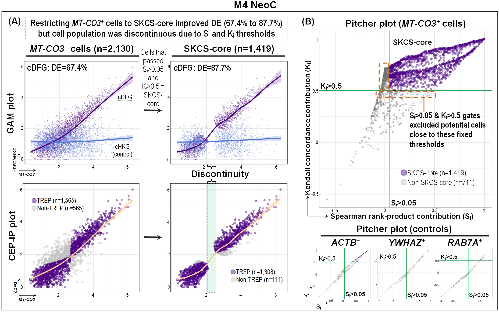
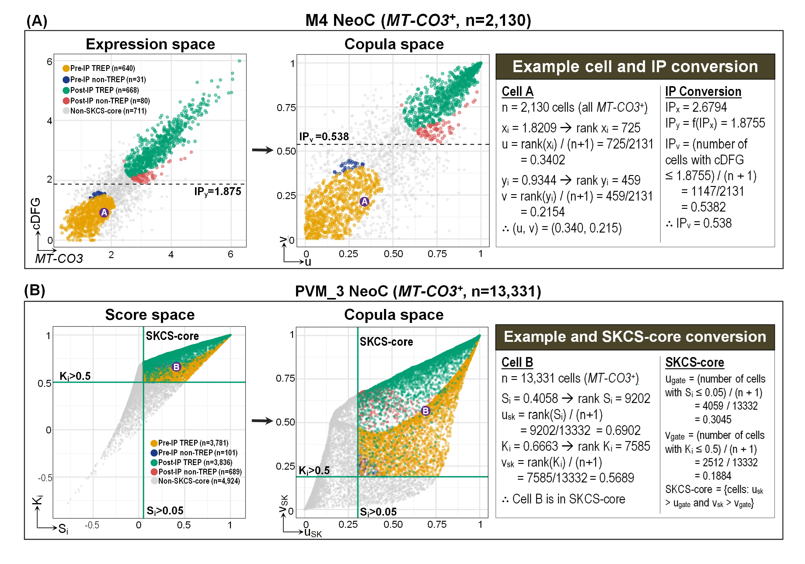
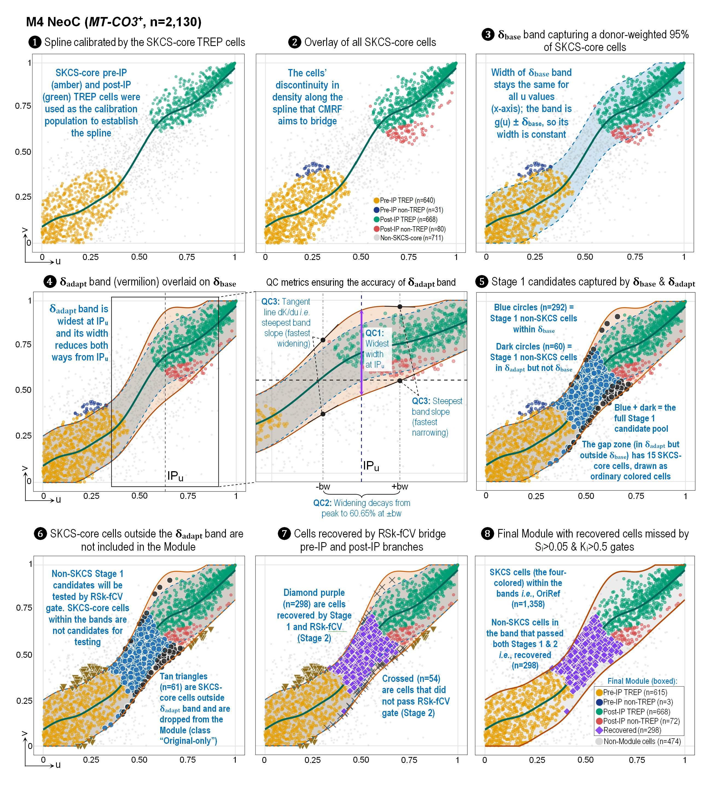
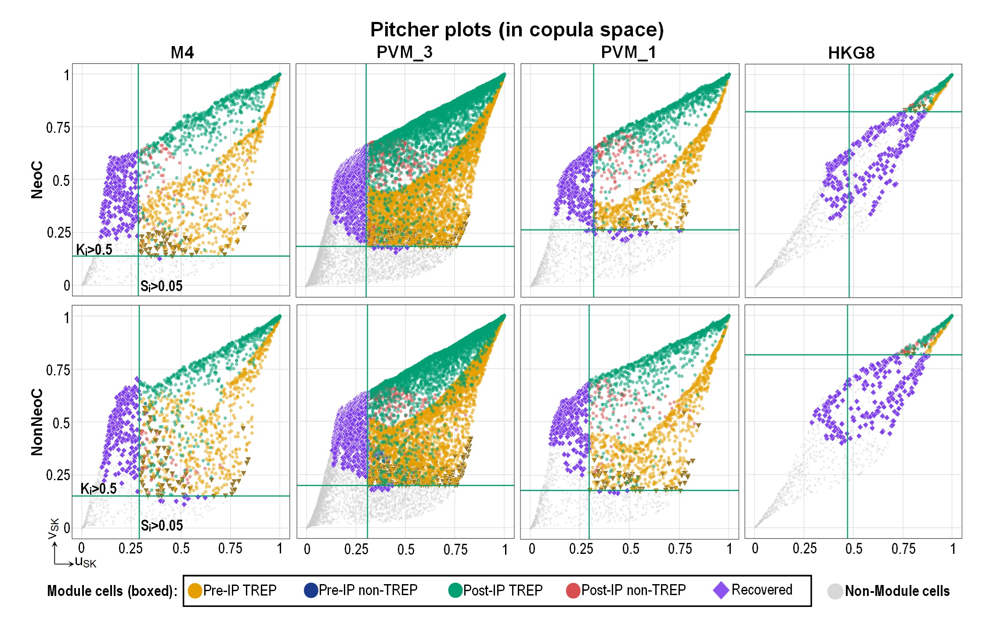
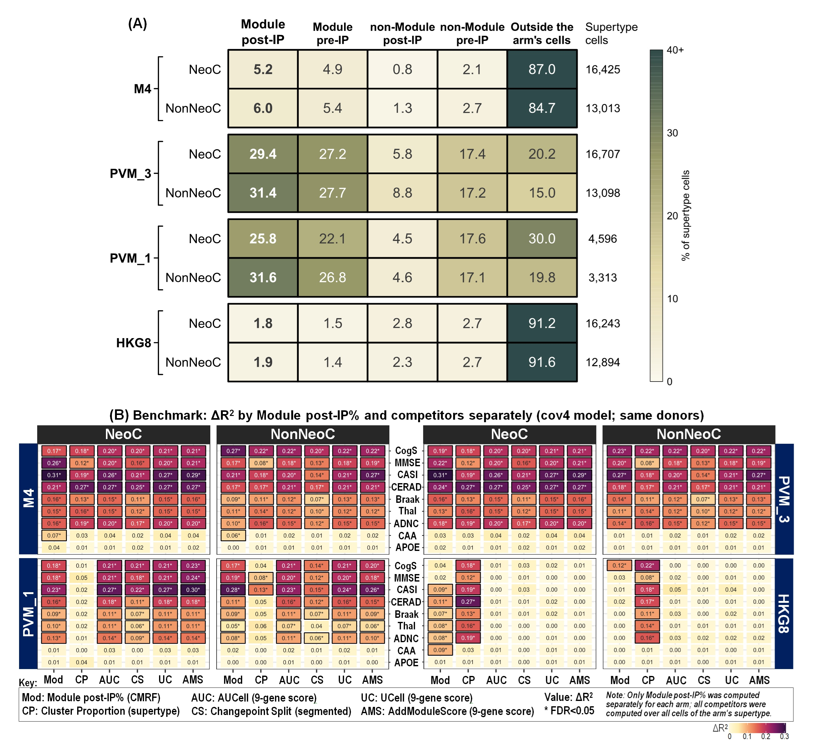

<div align="center">

# CEP-IP/CMRF in SEA-AD Microglia: A Mitochondrial Co-expression Module Linked to Cognition


[](https://github.com/kahkengwong/CEP-IP_and_CMRF_in_SEA-AD)
[](https://github.com/kahkengwong/CEP-IP_and_CMRF_in_SEA-AD)
[](https://github.com/kahkengwong/CEP-IP_and_CMRF_in_SEA-AD)
[](https://github.com/kahkengwong/CEP-IP_and_CMRF_in_SEA-AD)
[](https://huggingface.co/datasets/kahkengwong/CEP-IP_and_CMRF_in_SEA-AD)
[](https://zenodo.org/records/23445742)
[](https://doi.org/BIORXIV_DOI)
[](#reproducing-the-analysis)

**Author:** **Kah** **Keng** **Wong**

</div>

- The **CEP-IP** framework with a **copula monotone recovery filter (CMRF)** applied to the **SEA-AD** immune single-nucleus RNA-seq dataset (84 donors, 10 brain regions).
- A transcriptome-wide screen identified a module of **MT-CO3** and eight co-expressed mitochondrially encoded genes (cDFG).
- The donor percentage of **Module post-IP** cells was tested against cognition and pathology.
- Five **Batteries** of analyses tested contamination, measurement artifacts, %MT, and the 11 severely affected (SA) donors.

<details>
<summary><strong>Abstract (click to expand)</strong></summary>

Single-nucleus RNA-seq (snRNA-seq) studies of Alzheimer's disease (AD) routinely filter nuclei by mitochondrial fraction (%MT) or remove mitochondrial genes, yet whether these reads carry information about cognition is rarely examined. In SEA-AD microglia (84 donors, 10 brain regions), a transcriptome-wide screen identified a module of MT-CO3 and eight co-expressed mitochondrially encoded genes. Three microglial populations were analyzed, Mic.13-like, PVM_3, and PVM_1 cells, with a housekeeping-gene control. The CEP-IP pipeline with a copula monotone recovery filter (CMRF) used per-cell Spearman and Kendall scores, an inflection point (IP), and a cross-validated copula-space boundary to label Module cells. The donor percentage of Module cells past the IP (Module post-IP%) was associated with worse cognition (MMSE and CASI) in the three populations in neocortical and non-neocortical regions. These associations remained after adjustment for tissue quality, plaque and tangle burden, whereas most pathology associations were lost after adjustment for cognition. Tested together, Module post-IP% carried the cognition associations and non-Module post-IP% did not, and the housekeeping control showed no MMSE association. In Mic.13-like and PVM_3, the cognition associations held after contamination adjustment and doublet removal, Module post-IP% repeated across each donor's regions beyond chance, and no per-cell %MT cutoff reproduced the Module cells. However, Module post-IP% could not be separated from %MT, and the source of the mitochondrial transcripts, whether retained cytoplasm, ambient RNA, or a true change in mitochondrial content, remains unresolved. These findings suggest that mitochondrial reads in AD snRNA-seq should be checked before filtering, and the full pipeline code is publicly available.

> K.K. Wong (2026). PREPRINT_TITLE. *bioRxiv*. https://doi.org/BIORXIV_DOI

</details>

---

## Overview
- This repository holds the analysis code, the software environment (container recipe and lock files), and the reproduction check for the preprint. It builds on the published **CEP-IP framework** ([Wong, 2026, *CMPB*](https://doi.org/10.1016/j.cmpb.2026.109372); [code](https://github.com/kahkengwong/CEP-IP_Framework)).

- **Python Parts 1 to 8** read the SEA-AD immune h5ad: pre-checks, Mic.13-like (M4) cell selection, the GOI-DFG screens, DecontX, and the export of each arm for R.

- **R Parts 9 to 13** take the Part 8 export: GAM fits, the Spearman-Kendall cell-level scores (SKCS), the inflection point (IP and IPRS), copula space, the CMRF Module, differential expression, the donor-level clinical models, the Module boundary ablation, the five Batteries (Part 12), and the M4 analyses (Part 13).

**Four arms are analyzed in parallel:**
1. **M4** - Mic.13-like cells shortlisted from Micro-PVM_3 cells (primary arm).
2. **PVM_3** - all Micro-PVM_3 cells.
3. **PVM_1** - all Micro-PVM_1 cells.
4. **HKG8** - control: the M4 cells analyzed with ACTB as the gene of interest (GOI) and eight other housekeeping genes as its partners.

**Region sets:** neocortical regions (NeoC; DFC, MTG, AnG, STG, V1C, ITG) and non-neocortical regions (NonNeoC; HIP, MEC, LEC, FI).

---

### Datasets Used

**1. SEA-AD immune snRNA-seq dataset**, Multiregion release of 22 June 2026: `SEAAD_Immune_HIP_MEC_LEC_ITG_MTG_FI_STG_DFC_AnG_V1C_RNAseq_final-nuclei.2026-06-22.h5ad`, with the SEA-AD quantitative neuropathology (`sea-ad-quantitative-neuropathology-063026.xlsx`) and CPS (`sea-ad_global_and_local_cps_050126.xlsx`) workbooks. Available from the [SEA-AD portal](https://brain-map.org/consortia/sea-ad/our-data).
- M.I. Gabitto, K.J. Travaglini, V.M. Rachleff, E.S. Kaplan, B. Long, et al., Integrated multimodal cell atlas of Alzheimer's disease, Nat Neurosci, 27 (2024) 2366-2383. https://doi.org/10.1038/s41593-024-01774-5
- K.J. Travaglini, M.I. Gabitto, Y. Ding, A. Agrawal, N. Postupna, et al., Multiregional single-cell profiling reveals shared and specialized cellular vulnerability in Alzheimer’s disease, bioRxiv, (2026). https://www.biorxiv.org/content/10.64898/2026.07.01.734821v1

**2. Gerrits et al. single-nucleus dataset (GSE148822)**, used in Battery 1 (ambient RNA). Available from [GEO](https://www.ncbi.nlm.nih.gov/geo/query/acc.cgi?acc=GSE148822).
- E. Gerrits, N. Brouwer, S.M. Kooistra, M.E. Woodbury, Y. Vermeiren, et al., Distinct amyloid-beta and tau-associated microglia profiles in Alzheimer's disease, Acta Neuropathol, 141 (2021) 681-696. doi: 10.1007/s00401-021-02263-w

---

## Workflow of the Project
<!--  -->

- The **GOI-DFG screen** ranks every gene as a GOI against all expressed partner genes with the Spearman-Kendall dual filter (r<sub>s</sub> ≥0.6 and τ<sub>b</sub> ≥0.5). MT-CO3 was the top-ranked mitochondrial GOI, and its eight DFGs were averaged into the composite cDFG.

- The population r<sub>s</sub> and τ<sub>b</sub> of MT-CO3 with cDFG are decomposed into the cell-level scores S<sub>i</sub> and K<sub>i</sub>. Cells passing cutoffs on both form the **SKCS-core**.

- The **inflection point (IP)** is located on a GAM fit of cDFG on MT-CO3, and the fitted cDFG at the IP (IP<sub>y</sub>) splits cells into **pre-IP** and **post-IP**.

- In copula space, the **CMRF** recovers cells that follow the same monotonic relationship as the SKCS-core, with a cross-validated boundary, to form the **Module**.

- The donor percentage of Module cells at or above IP<sub>y</sub> (**Module post-IP%**) is tested against clinical outcomes, then challenged by the five Batteries.

---

## Methods and Key Results
The five figures below follow the main steps of the analysis, using M4 NeoC as the example where one arm is shown.

<p align="center">i</sub> and K<sub>i</sub> gates create a discontinuity."></p>

**Figure 1. The S<sub>i</sub> and K<sub>i</sub> gates create a discontinuity.** The S<sub>i</sub> and K<sub>i</sub> gates (S<sub>i</sub> >0.05 and K<sub>i</sub> >0.5) identified the SKCS-core cells and improved the deviance explained (DE; from 67.4% to 87.7% in M4 NeoC), but created a discontinuity along MT-CO3 that is also visible in the pitcher plot (K<sub>i</sub> against S<sub>i</sub>).

<p align="center"></p>

**Figure 2. Transformation into copula space.** The expression space (cDFG against MT-CO3) and the score space (K<sub>i</sub> against S<sub>i</sub>) are transformed into copula space by ranking each axis and dividing by n + 1: v against u for the expression values, and v<sub>SK</sub> against u<sub>SK</sub> for the S<sub>i</sub> and K<sub>i</sub> values.

<p align="center"></p>

**Figure 3. CMRF reclaims monotone-coherent cells.** The copula monotone recovery filter (CMRF) reclaimed monotone-coherent cells that the fixed S<sub>i</sub> and K<sub>i</sub> gates had excluded. The SKCS-core cells calibrated the spline, two bands (&delta;<sub>base</sub> and &delta;<sub>adapt</sub>) identified the candidates, and the RSk-fCV gate tested them. Purple diamonds are the Recovered cells.

<p align="center"></p>

**Figure 4. Pitcher plots as a quality check of CMRF.** Pitcher plots in copula space for each arm and region set. The Recovered cells (purple) bridge the post-IP (green) and pre-IP (amber) branches.

<p align="center"></p>

**Figure 5. Applications of Module post-IP%.** Module post-IP% was computed for each arm (A) and used in downstream applications, such as its association with cognition and pathology outcomes in the SEA-AD donors, where it was benchmarked against the competitors of CMRF (B).

---

## Repository Contents
| Path | Contents |
|---|---|
| `scripts/Python/` | The 23 Python scripts: Parts 1 to 8 and the Part 12 extraction step (`Part12_02_Extract.py`). |
| `scripts/R/` | The R scripts of Parts 9 to 13 and `Fig17_Summary_code.r`; the shared arm table and settings (`CEP_arms.R`, `R_config.R`, `R_config_HKG8.R`); the Part 12 settings (`Part12_01_config.json`, `Part12_Fig19_config.json`) and pre-specified readings (`Part12_Preset_Readings.md`, `Part12_Preset_Readings_Battery5.md`). |
| `Containerfile` | Recipe for the container image (R 4.6.1, Python 3.13.14, all packages). Works with Podman or Docker. |
| `seaad-setup.sh` | Run once inside the container: copies the settings into the data folder and checks the inputs. |
| `README_container.md` | Container build, inputs, and the full run order. |
| `renv.lock` | Exact R package versions (R 4.6.1, Bioconductor 3.23; 280 packages). |
| `requirements-python.txt` | Exact Python package versions (Python 3.13.14). |
| `verification/` | `run_rest.sh` and `run_python.sh` (run the R and the Python scripts in order from a named step), `compare_rerun.py`, `compare_python.py` and `compare_gamdata.py`, and the comparisons of the container reruns with the original results (`compare_all_*` for R; `compare_python_*` and `compare_gamdata_log.txt` for Python). |
| `figures/` | Figures 1 to 5 of the Methods and Key Results section. |
| `logs/` | Console logs of the container reruns (`container_rerun/`, R Part 9 onward and the Part 12 Python step; `container_rerun_python/`, Python Parts 1 to 8), logs of the original runs from Part 9 onward (`original_R/`), and logs of the original Python Parts 1 to 8 (`original_python/`). `logs/README.md` describes each folder and maps the Python logs to their scripts. |

---

## Descriptions of the Scripts
Figure and table numbers are those of the preprint. The Part 12 file names (`Fig15` to `Fig19`) follow the run order of the Batteries; they correspond to preprint Figures 12 to 16.

### Python (SEA-AD h5ad)
| No | Script File | Description | Paper output |
|----|---|---|---|
| 1 | `Part1a_NormForensics_code.py` | Identifies the normalisation behind the expression matrix. | Pre-check |
| 2 | `Part1b_MT-audit_code.py` | Mitochondrial audit: layers, ambient-correction traces, mitochondrial genes and %MT. | Figure 1G |
| 3 | `Part1c_WithinDonor_code.py` | Splits the pooled MT-CO3 to cDFG correlation into within-donor and between-donor parts. | Pre-check |
| 4 | `Part1d_Errata_code.py` | Checks the SEA-AD specimen errata against the h5ad. | Pre-check |
| 5 | `Part1e_TechQC_code.py` | Technical-confound checks (library batch, intronic:exonic ratio). | Pre-check |
| 6 | `Part1f_Ordinals_code.py` | Clinical ordinals and donor table with tissue-quality covariates. | Pre-check |
| 7 | `Part1g_TrendReconcile_code.py` | Detectability trend on two abundance axes. | Figure 1G |
| 8 | `Part2_NeoC_CP10K_code.py`<br>`Part2_NonNeoC_CP10K_code.py` | M4 selection with the Mic.13 signature; writes the donor clinical tables. | Supplementary Figure S1A, Table S1 |
| 9 | `Part3_M4Composition_code.py` | Supertype composition of the M4 set. | Figure 1B |
| 10 | `Part4_NeoC_ScreenScatter.py`<br>`Part4_NonNeoC_ScreenScatter.py` | PVM_3 pooled GOI-DFG screen. | Figure 1D |
| 11 | `Part5_NeoC_DEGs.py`<br>`Part5_NonNeoC_DEGs.py` | Pseudobulk DEGs of M4 cells. | Figure 1 |
| 12 | `Part5b_NeoC_Validation.py`<br>`Part5b_NonNeoC_Validation.py` | Mic.13 equivalence validation. | Figure 1 |
| 13 | `Part6_NeoC_GOI-DFG_code.py`<br>`Part6_NonNeoC_GOI-DFG_code.py` | GOI-DFG screen by region and supertype. | Figure 1, Tables S2 to S4 |
| 14 | `Part6b_NeoC_Pooled_GOI-DFG.py`<br>`Part6b_NonNeoC_Pooled_GOI-DFG.py` | Pooled GOI-DFG screen in seven immune supertypes. | Figure 1, Tables S2 to S4 |
| 15 | `Part7_DecontX.py` | DecontX ambient RNA estimate per library. | Table S6 |
| 16 | `Part8_Data-export-CP10K_MT-CO3_8DFG.py` | Exports one arm for the R parts (run once per arm). | Input to Parts 9 to 13 |
| 17 | `Part12_02_Extract.py` | Part 12 step 02: extracts the cells and counts the Batteries use. | Input to Part 12 |

### R (Part 8 export)
| No | Script File | Description | Paper output |
|----|---|---|---|
| 1 | `Part9_CP10K_QC_GAM_code.r` | Export QC, heatmaps and GAM fits. | Figure 2, Supplementary Figures S2, S3, S5, Table S7 |
| 2 | `Part9b_CP10K_SiKi_code.r` | Justifies the S<sub>i</sub> floor. | Supplementary Figure S4, Table S7 |
| 3 | `Part10_CP10K_SKCS_code.r` | SKCS decomposition and TREP classification. | Figures 2 and 3, Supplementary Figures S5 and S7, Table S7 |
| 4 | `Part10b_CP10K_IPRS_code.r` | Inflection point detection and IPRS. | Figure 3, Supplementary Figure S6, Table S8 |
| 5 | `Part10b_CP10K_SKCS_TREP_code.r` | SKCS fixed thresholds and IP x TREP classes. | Table S7 |
| 6 | `Part10c_CP10K_Copula1_code.r` | Copula space. | Figure 4, Supplementary Figures S8 to S10, Table S9 |
| 7 | `Part10d_CP10K_Copula2_code.r` | The IP and gates in copula coordinates. | Figure 4, Supplementary Figures S8 to S10, Table S9 |
| 8 | `Part10e_CP10K_CMRF_code.r` | Copula monotone recovery filter (CMRF). | Table S10 |
| 9 | `Part10e_CP10K_Validation1_code.r` | GAM refit on the final Module. | Figure 8A, Table S10 |
| 10 | `Part10e_CP10K_Validation2_UMAP_code.r` | CMRF classes in a raw-count UMAP. | Figure 8B and 8C, Table S10 |
| 11 | `Part10f_CP10K_Band_Formation_code.r` | Band-formation figures. | Figure 6, Supplementary Figures S11 and S12 |
| 12 | `Part10f_CP10K_CMRF_RSkfCV_Mechanism_code.r` | How the RSk-fCV gate works. | Figure 7 |
| 13 | `Part10g_CP10K_DEGs_Part1_code.r` | Paired pseudobulk differential expression in the Module. | Table S11 |
| 14 | `Part10g_Step7to9_rebuild_code.r` | Targeted tests, control overlap and ambient check. | Table S11 |
| 15 | `Part10h_CP10K_Prognosis_code.r` | Donor-level clinical models. | Figure 9A, Supplementary Figure S14, Table S12 |
| 16 | `Part10h_CP10K_Prognosis_1_Comparator_code.r` | Comparison with five external baselines. | Figure 10A and 10B, Table S12 |
| 17 | `Part10h_CP10K_Prognosis_2_CogVsPath_code.r` | Cognition against pathology. | Figure 9B and 9C, Table S12 |
| 18 | `Part10h_CP10K_Prognosis_4_Multivariate_code.r` | Module against a gene score plus a cell count. | Figure 10C and 10D, Table S12 |
| 19 | `Part10h_CP10K_Comparator_Fig13_code.r` | Draws the comparator figures. | Figure 10A to 10D |
| 20 | `Part11_CP10K_CogVsPath_code.r` | Module minus non-Module contrast. | Figure 9D, Table S12 |
| 21 | `Part11_CP10K_CogVsPath_HighLevel_code.r` | Summary panel of the four cell populations. | Figure 9E |
| 22 | `Part11_Identity_BandAblation_code.r` | Module boundary ablation. | Figure 11A and 11C, Table S12 |
| 23 | `Part11_BandAblation_Fig11Export_code.r` | Boundary lines and cell membership. | Figure 11B, Table S12 |
| 24 | `Part12_03_Config.r` | Shared settings and functions of Part 12 (sourced by each step). | - |
| 25 | `Part12_04_Labels.r`<br>`Part12_05_Units.r`<br>`Part12_06_GerritsCells.r` | Cell labels, donor-region units, and Gerrits cells. | Inputs to the Batteries |
| 26 | `Part12_Fig15_Analysis.r`<br>`Part12_Fig15_Plots.r` | Battery 1: contamination. | Figure 12, Table S13 |
| 27 | `Part12_Fig16_Analysis.r`<br>`Part12_Fig16_Plots.r` | Battery 2: measurement. | Figure 13, Table S14 |
| 28 | `Part12_Fig17_Analysis.r`<br>`Part12_Fig17_Plots.r` | Battery 3: Module post-IP% and %MT on histology and clinical outcomes. | Figure 14, Table S15 |
| 29 | `Part12_Fig18_Analysis.r`<br>`Part12_Fig18_Plots.r` | Battery 4: can %MT replace the Module. | Figure 15, Table S16 |
| 30 | `Part12_Fig19_Analysis.r`<br>`Part12_Fig19_Plots.r` | Battery 5: the 11 severely affected donors. | Figure 16, Table S17 |
| 31 | `Part12_ModulePostIP_Overview.r` | Module post-IP% overview. | Supplementary Figure S13 |
| 32 | `Part10g_CP10K_DEGs_Part1_code_S11_followup_analyses.r` | Follow-up DE analyses (reads the Part 12 labels). | Table S11 |
| 33 | `Part13a_CP10K_Find14DpctMT_code.r` | Donor %MT for the Part 13 model. | Input to Part 13 |
| 34 | `Part13_CP10K_M4Share_code.r` | Does the donor's M4 share explain the M4 results. | Supplementary Figure S20, Table S18 |
| 35 | `Part13b_CP10K_M4RandomSubset_code.r` | M4 cells against random PVM_3 cells. | Supplementary Figure S21, Table S18 |
| 36 | `Fig17_Summary_code.r` | Summary of all tests of Module post-IP%. | Figure 17, Table S19 |

Two scripts read finished supplementary tables instead of recomputing them: the Part 10g follow-up reads Table S11, and `Fig17_Summary_code.r` reads Tables S12 to S17 together with the Part 13 and 13b outputs. These tables are on [Zenodo](https://zenodo.org/records/23445742). `README_container.md` gives the paths where they are placed.

---

## Reproducing the Analysis
The analysis runs in a container that holds R 4.6.1, Python 3.13.14 and every package at the version in the lock files. No data are inside the container: the data folder is mounted at `/data` when it starts, and every script reads and writes in that folder.

### 1. Get the data
| Source | Files | Needed for |
|---|---|---|
| [HuggingFace](https://huggingface.co/datasets/kahkengwong/CEP-IP_and_CMRF_in_SEA-AD) | `R_export_CP10K/` (Part 8 export of the four arms, about 14 GB), the Part 2 donor tables (`NeoC_S5b_donor_clinical.csv`, `NonNeoC_S5b_donor_clinical.csv`), and `Part7_DecontX/decontX_contamination_all.csv` | R Parts 9 to 13 |
| [SEA-AD portal](https://brain-map.org/consortia/sea-ad/our-data) | Immune h5ad (2026-06-22 release), neuropathology and CPS workbooks | Python Parts 1 to 8, Part 12 |
| [GEO GSE148822](https://www.ncbi.nlm.nih.gov/geo/query/acc.cgi?acc=GSE148822) | Gerrits deposit, placed in `Gerrits/` with the series matrix in `Gerrits/Metadata/` | Part 12 (Battery 1) |
| [Zenodo](https://zenodo.org/records/23445742) | Supplementary Tables | The Part 10g follow-up and `Fig17_Summary_code.r` |

Place them in one folder (the data folder), keeping the folder names above.

### 2. Build the container
Download this repository (green "<> Code" button, then "Download ZIP") and extract it. From the extracted folder:
```bash
podman build -t seaad-cepip -f Containerfile .
```
The first build takes about one to two hours, mostly to compile the Bioconductor packages and monocle3. Docker accepts the same commands with `docker` in place of `podman`.

Instead of building it, the image can be loaded from the archived copy on Zenodo (`seaad-cepip_image.tar.gz`, 1.7 GB, https://doi.org/10.5281/zenodo.23446228), which holds the same software and scripts:
```bash
podman load -i seaad-cepip_image.tar.gz
```
This gives the image `localhost/seaad-cepip`; Docker accepts `docker load -i` in the same way.

### 3. Start the container and check the inputs
```bash
podman run --rm -it --shm-size=16g -v /path/to/data_folder:/data:Z seaad-cepip
seaad-setup
```
`--shm-size=16g` gives the container enough shared memory for Part 7 (DecontX), whose worker processes share the count matrix. Without it, Part 7 stops with a bus error.

`seaad-setup` copies the settings files and the Part 12 scripts into the data folder and lists every input as found or missing.

### 4. Run the scripts
From `/data`, in the order given in `README_container.md`. For example:
```bash
Rscript -e 'source("/opt/seaad/R/Part9_CP10K_QC_GAM_code.r")'
python Part12_rerun/Part12_02_Extract.py
Rscript -e 'source("Part12_rerun/Part12_04_Labels.r")'
```
Each script writes its outputs and a log in its own folder.

`verification/run_rest.sh` runs the scripts from a given one to `Fig17_Summary_code.r` in order, saves each console log in `console_logs/`, and then runs the comparison. It was used for the reproduction check below; the comparison step needs the original results mounted at `/win`. To use it, copy `run_rest.sh` and `compare_rerun.py` into the data folder and run, for example, `bash /data/run_rest.sh Part10h_CP10K_Prognosis_code`. `verification/run_python.sh` does the same for Python Parts 1 to 8 (Part 8 once per arm) and then runs `compare_python.py` against the original results mounted at `/ref`.

### Without the container (optional)
- **R:** run `renv::restore()` in the repository folder to install the package versions in `renv.lock`. renv uses an isolated library and does not change the existing R setup.
- **Python:** `pip install -r requirements-python.txt` in a Python 3.13.14 environment.
- Set the environment variable `SEAAD_ROOT` to the data folder, or start R or Python from that folder.

---

## Reproduction Check
The original analysis ran R on Windows 11 and Python on Fedora 44. The whole pipeline was then rerun inside this container on Fedora: Python Parts 1 to 8 from the SEA-AD h5ad, and R Parts 9 to 13 from the Part 8 export. Every table was compared with the original results by `verification/compare_rerun.py`.

- **Method:** every CSV and Excel table is compared cell by cell. Numbers agree when they are within a relative difference of 1e-6, and text must match exactly.

- **Result, Python Parts 1 to 8:**
  - All 25 steps ran to completion (Part 8 once per arm), in about three hours.
  - The 54 count matrices and cell and gene lists exported by Part 8 (the four arms and the full data of both region sets) are identical byte for byte to the original export used by the R analyses.
  - Of the 9,262 tables found in both runs, 9,211 are the same. A further 40 Part 8 `gam_data` tables are the same in every shared column; the original files hold 1 or 10 more gene columns, added later by R Part 9.
  - Nine Part 5 differential expression tables differ in one to three genes each: the paired p-values of TAOK3, LINC02391, and NBAS changed slightly, with the adjusted p-values of the genes next to them in rank, and the log2FC of five genes changed in the fourth decimal. No gene crosses the 0.05 cutoff.
  - Two Part 8 record files differ only in how a logical value is written (`False` against `FALSE`).
  - The reference was the Windows copy of the original results, which the R analyses used. Tables found only there come from scripts that are not part of this deposit.

- **Result, R Parts 9 to 13:**
  - All R scripts from Part 9 onward, and the Part 12 Python step, ran to completion in the container.
  - Of the 1,203 tables found in both runs, 1,013 are the same, 110 differ only in sign, row order, or text, and 23 differ by at most 0.1%.
  - A further 53 tables differ by more than 0.1%. These are secondary statistics that depend on random subsamples, permutations, or nearest neighbours:
    - the TOST, PERMANOVA and PERMDISP, kBET, iLISI, and neighbour-proportion tests of Part 10e Validation2 (with their columns in the Figure 11 summary);
    - the permutation null threshold of Part 10f;
    - the Part 12 depth-thinning curve;
    - some donor-level p-values in four Part 10g tables, none of which changes a significance call.
  - Four tables differ in size because a checksum column was removed from the deposited scripts, or because the original folder held more files to scan.
  - Tables found only in the original results come from scripts or steps that are not part of this deposit.

- **Expected differences:**
  - eigenvector signs in the GAM basis-function tables (either sign is a valid solution);
  - the sign of values printed as zero;
  - quote marks written by R's `shQuote()` (double on Windows, single on Linux);
  - the settings version recorded in the Part 12 tables;
  - dates, times, and folder paths.

The full comparison is in `verification/compare_all_log.txt` (summary) and `verification/compare_all_detail.csv` (one row per table) for the R parts, and in `verification/compare_python_tables_log.txt`, `compare_python_tables_detail.csv`, `compare_python_matrices_log.txt` and `compare_gamdata_log.txt` for the Python parts.

---

## Supplementary Tables & Figures (Zenodo)
- Supplementary Tables (Excel format) and Supplementary Figures are available from [Zenodo](https://zenodo.org/records/23445742).
- Refer to these tables to see the results without running the pipeline, or to check your own results.

---

## Requirements
### Software Requirements
- **R:** 4.6.1, with Bioconductor 3.23 (280 packages in `renv.lock`, including monocle3, presto and BPCells from GitHub)
- **Python:** 3.13.14 (packages in `requirements-python.txt`)
- **Container:** Podman or Docker (base image `rocker/r-ver:4.6.1`, Ubuntu 24.04)

### Hardware Requirements
- **RAM:** 32 GB (64 GB recommended for the Python parts that read the full h5ad)
- **CPU:** 8 cores (12+ cores recommended; the GAM fits and resampling run in parallel)
- **Storage:** about 60 GB free disk space for the inputs, the container image and the outputs

### Development Environment
- **Developed and tested on:** Intel Core i9-14900KF, 64 GB DDR5 RAM, Windows 11 Pro (R 4.6.1) and Fedora 44 (Python 3.13.14)

### Performance Notes
- All analyses are CPU-based; GPU acceleration is not required.
- Run times in the container on the development machine:
  - Python Parts 1 to 8: about three hours (Part 6b about 80 minutes, Part 7 about 40 minutes)
  - R Parts 9 to 10d: about 35 minutes
  - Parts 10e to 10g: about 45 minutes
  - the four Part 10h model scripts: about 45 minutes
  - `Part10h_CP10K_Comparator_Fig13_code.r` to `Fig17_Summary_code.r` (including the Part 12 Batteries): about 20 minutes

---

## License
This project is licensed under the [MIT License](https://github.com/kahkengwong/CEP-IP_and_CMRF_in_SEA-AD/blob/main/LICENSE). For the full details, please refer to the [LICENSE](https://github.com/kahkengwong/CEP-IP_and_CMRF_in_SEA-AD/blob/main/LICENSE) file in this repository.

---

## Contributing
Contributions, issues, and feature requests are welcome!

### Found a Bug?
[Open an issue](https://github.com/kahkengwong/CEP-IP_and_CMRF_in_SEA-AD/issues) describing the problem, including your error message, R or Python version, and operating system.

### Want to Contribute Improvements?
If you've made enhancements you'd like to share with others, you can contribute back via a **pull request** (i.e., a way to propose merging your improvements back into the main repository so others can benefit).

**How to submit:**
1. Make changes in your forked copy
2. Click "Contribute" → "Open pull request" on your fork's GitHub page
3. Describe your changes and submit

I'll review and may ask questions before merging. **Or simply:** [Open an issue](https://github.com/kahkengwong/CEP-IP_and_CMRF_in_SEA-AD/issues) describing your idea.

---

## Citation
If you found this study useful, please cite:

K.K. Wong. PREPRINT_TITLE. *bioRxiv* (2026). https://doi.org/BIORXIV_DOI

K.K. Wong. CEP-IP: An explainable framework for cell subpopulation identification in single-cell transcriptomics. *Computer Methods and Programs in Biomedicine*, 282 (2026) 109372. https://doi.org/10.1016/j.cmpb.2026.109372

Please also cite the source datasets (see Datasets Used).

---

## Contact
Kah Keng Wong: [kahkeng@usm.my](mailto:kahkeng@usm.my)

---
